# Jubely — conceptual architecture diagrams

## 1) Product / actor map

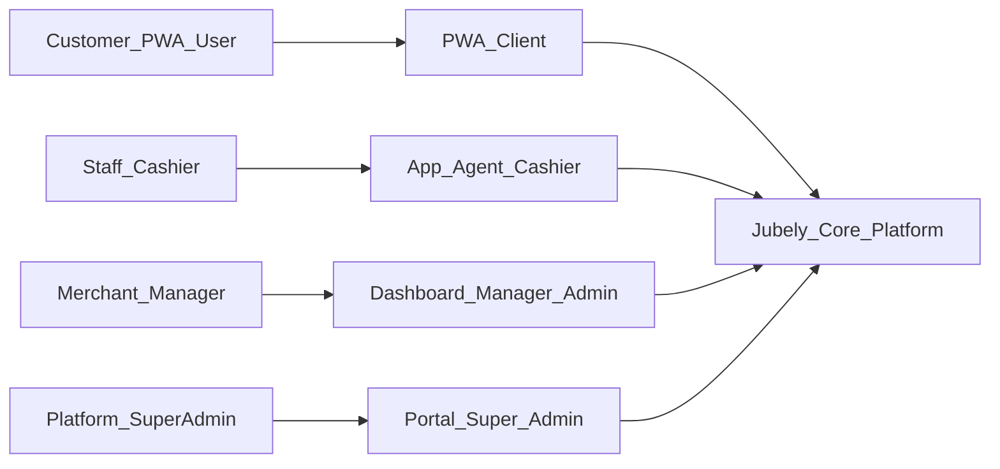

## 2) C4 Level 1 — System context

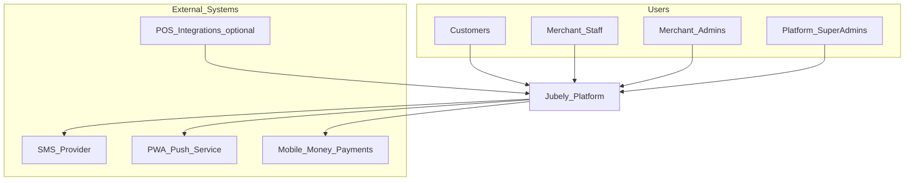

## 3) C4 Level 2 — Container diagram (conceptual)

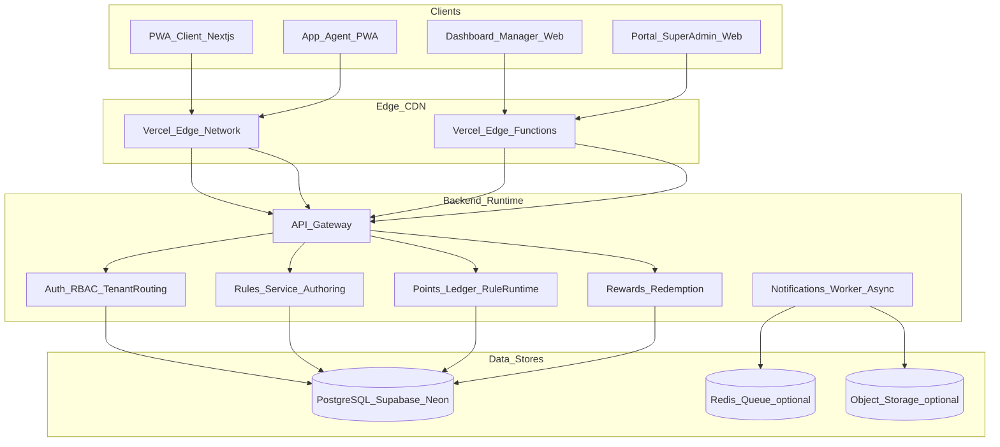

## 4) Domain model (conceptual)

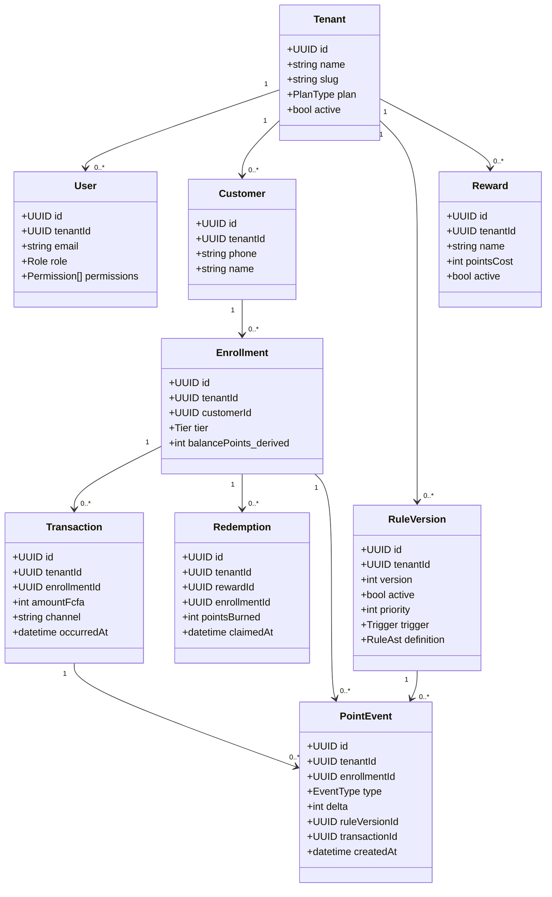

## 5) Core flows (sequence diagrams)

### 5.1 Earn points (cashier flow)

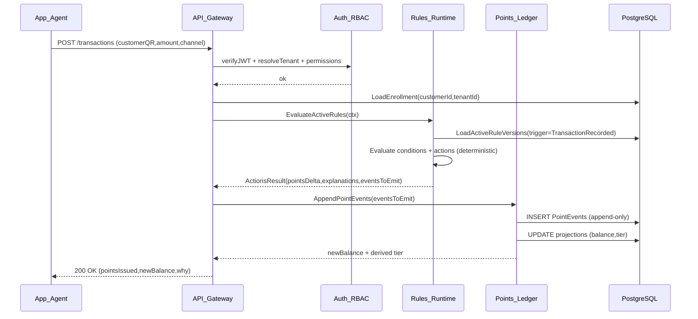

### 5.2 Redeem reward (simple MVP)

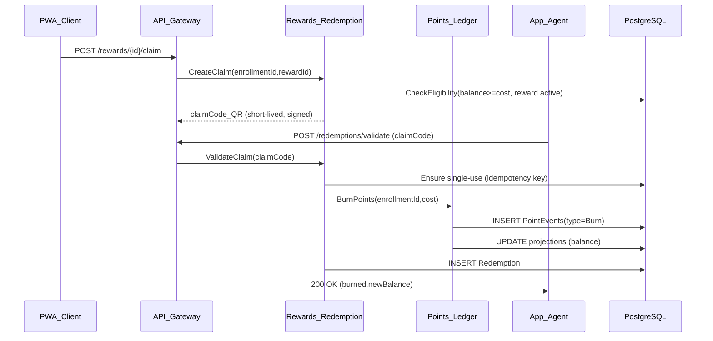

### 5.3 Rules lifecycle (draft → simulate → publish)

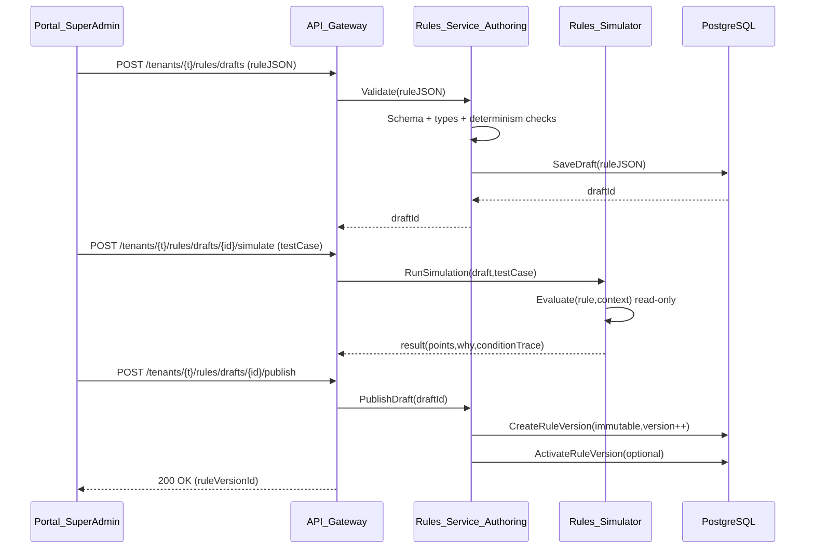

## 6) Rules engine pipeline (runtime)

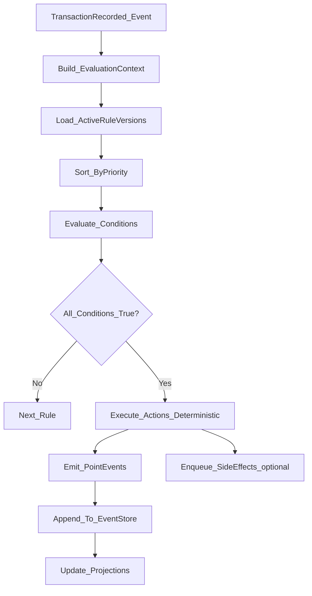

## 7) Event sourcing + projections (data architecture)

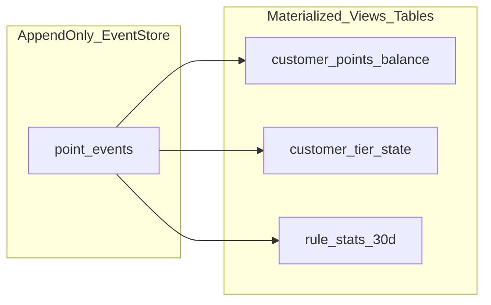

## 8) Deployment / trust boundaries (refined from your sketch)

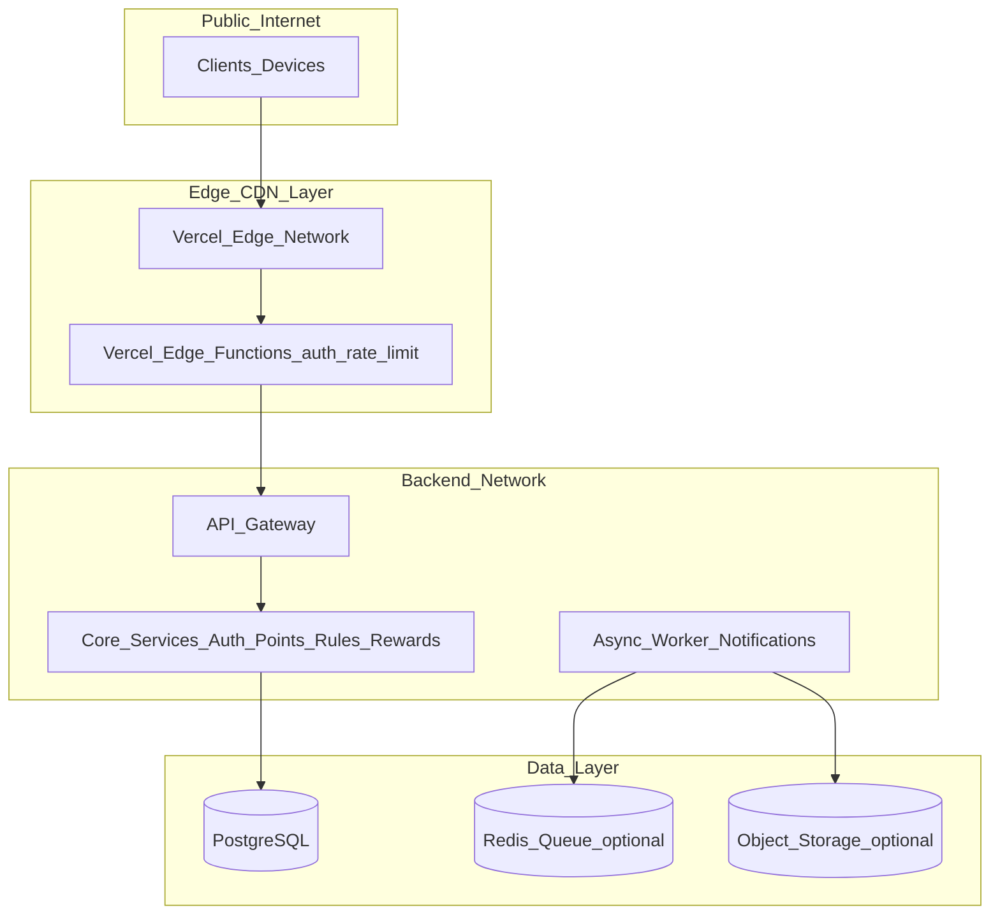

## 9) Observability + audit (conceptual)

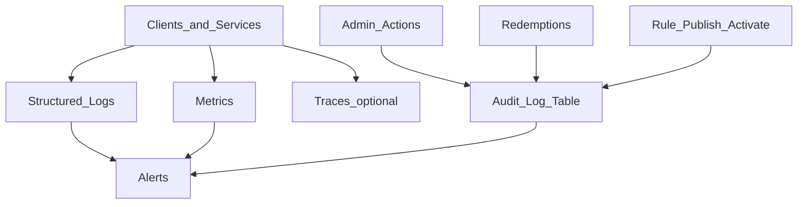

